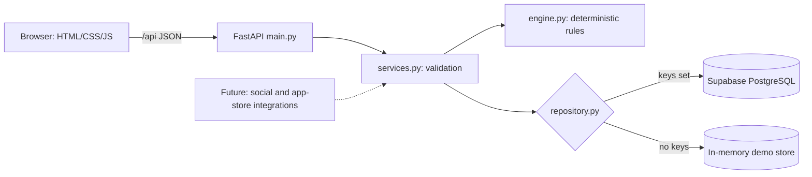

# Digital Risk Shield

Prototype for HacXLerate 2026 (Digital Risk Protection: Social & App Monitoring). It checks a submitted social
username/URL or app name/store link against your registered brand assets and returns a deterministic risk score
(0-100), a level, up to three reasons and a recommendation.

**What it does not do:** it does not query Instagram, Facebook, X, LinkedIn or any app store. It analyzes only the
text you submit. A URL alone does not prove an account is fake, so results say "Potential impersonation" or
"Needs review", never "fake".

## Project layout
```
schema.sql                 database tables (run in Supabase)
backend/app/engine.py      detection rules (pure Python, start reading here)
backend/app/services.py    validation + glue between API, engine and storage
backend/app/repository.py  Supabase storage + in-memory demo storage
backend/app/main.py        FastAPI routes; also serves the frontend
frontend/                  index.html, style.css, app.js
tests/                     unit tests + sample_cases.json
```

## Run it locally (demo mode, no database needed)
```bash
python -m venv .venv && source .venv/bin/activate      # Windows: .venv\Scripts\activate
pip install -r requirements.txt
cd backend
uvicorn app.main:app --reload
```
Open http://127.0.0.1:8000. A yellow banner says **Demo mode**: scans work, but data lives in memory and is lost
when the server restarts. On the dashboard click **Load NovaPay demo brand** (fictional) to try the samples.

## Connect Supabase (permanent storage)
1. Create a project at supabase.com.
2. Open **SQL Editor > New query**, paste all of `schema.sql`, click **Run**. This creates `brands`,
   `official_assets`, `scan_results`, and turns on Row Level Security with no public policies.
3. Open **Project Settings > API**. Copy the **Project URL** and the **service_role** key.
4. Copy `.env.example` to `backend/.env` and fill in `SUPABASE_URL` and `SUPABASE_SERVICE_KEY`.
5. Restart the server. The banner turns green: "Connected to Supabase".

If the keys are missing or wrong, the app falls back to demo mode and the banner says why. If the database fails
mid-session, the API returns a clear 503 message instead of crashing.

**Security notes**
- The service-role key lives only in `backend/.env` (git-ignored) or your host's environment settings. The
  frontend never sees it; it only calls `/api/*`.
- RLS is enabled with no policies, so the public anon key cannot read or write these tables. Only the backend can.
- The Supabase client sends parameterized requests; the frontend writes user text with `textContent`, not `innerHTML`.
- There is no login. Anyone who can open the site can scan and edit the brand profile. Add authentication before
  any real deployment.

## Deploy (example: Render)
Create a Web Service from your repo. Build command `pip install -r requirements.txt`; start command
`cd backend && uvicorn app.main:app --host 0.0.0.0 --port $PORT`. Add `SUPABASE_URL` and `SUPABASE_SERVICE_KEY`
as environment variables in the dashboard. Railway and Fly.io work the same way.

## How scoring works (all in `engine.py`)
| Signal | Points |
|---|---|
| Name contains the brand name | 35 |
| Close / loose spelling match (fuzzy) | 30 / 18 |
| Look-alike characters (0 for o) | +10 |
| Extends an official handle | +15 |
| Suspicious words (support, help, rewards, claim, giveaway...) | 25, +10 each more, max 40 |
| Scam-style description | 15 each, max 30 |
| Number suffix | +5 |
| App: same name, different publisher | 60 |
| App: similar name, publisher differs / missing | +30 / +15 |

Levels: 0-24 Low, 25-49 Medium, 50-74 High, 75-100 Critical. Exact matches to registered usernames (or a registered
app with the matching publisher) are marked official, score 0, and never count as high-risk. Suspicious words
only score fully when something also links the account to your brand. Tune the tables at the top of `engine.py`.

Known limits: Play Store links give a package id (e.g. `com.x.y`), so type the app name for best results;
fuzzy matching on very short brand names can over- or under-flag.

## Adding real integrations later
Add a function that fetches live profile or app data (platform API, store listing) and passes its fields
(display name, bio, publisher) into `engine.analyze_social` / `analyze_app` as `description` and `publisher`.
Call it from `services.scan_social` / `scan_app`. Nothing else needs to change.

## Architecture


## Tests
```bash
PYTHONPATH=backend python -m unittest discover -s tests -v     # Windows PowerShell: $env:PYTHONPATH="backend"
```
Covered: official exclusion, name similarity, suspicious terms and descriptions, missing optional fields, score
range/levels/determinism, input validation, brand save/edit, scan persistence and dashboard counts (against both
the memory repository and the Supabase repository using a fake client), database-failure handling, demo fallback.
`tests/test_api.py` runs the HTTP endpoints and is skipped if FastAPI is not installed.
Sample inputs live in `tests/sample_cases.json`.

## Manual test checklist
- [ ] Server starts; banner shows Demo mode (no keys) or Connected (with keys).
- [ ] Dashboard empty state shows; **Load NovaPay demo brand** works and Brand setup is filled in.
- [ ] Social: `novapay_official` is Registered official asset, score 0, not counted in High-risk findings.
- [ ] Social: `novapay_support24` and `nova_pay_rewards` show High or Critical with 2-3 reasons and "Potential impersonation".
- [ ] Social: pasting `https://instagram.com/novapay_support24/` gives the same result as the username.
- [ ] Social: `random_cook` is Low.
- [ ] App: `NovaPay Wallet` + publisher `NovaPay Technologies Ltd` is official.
- [ ] App: `NovaPay Wallet Pro` with no publisher is flagged; `NovaPay Wallet` + `Quick Apps LLC` is flagged for publisher mismatch.
- [ ] Scan the same input twice: identical score and reasons.
- [ ] New brand with only a name and no other fields: a scan still works.
- [ ] Empty required field shows a clear error; loading spinner appears while scanning; **Scan another** clears the form.
- [ ] Dashboard counters and history update; NovaPay rows carry a "fictional demo" tag.
- [ ] Restart the server: in demo mode history is gone (expected); with Supabase it remains.
- [ ] Break the Supabase key: banner explains the fallback to demo mode.
- [ ] Resize to phone width: nav scrolls horizontally, layout stacks, table scrolls sideways.
- [ ] Search the page source and network tab: no Supabase key appears.
